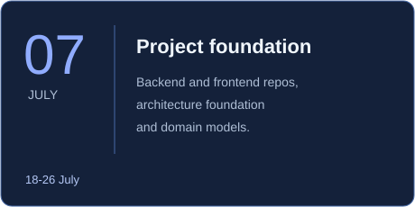
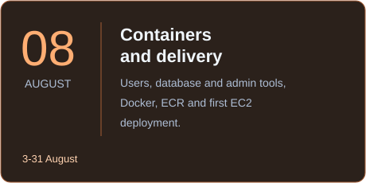
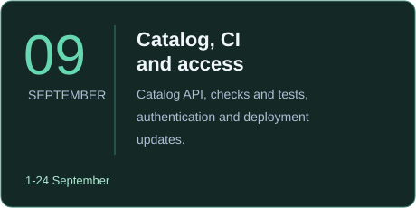
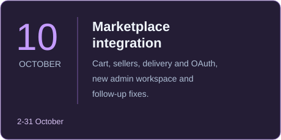
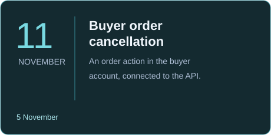

[🇺🇦 Українська](profile/README.md) · **🇬🇧 English**

 

# 🛒 Treba Marketplace

### Marketplace · Cloud infrastructure · DevOps

A team marketplace with a product catalog, cart, orders, and dedicated spaces for buyers, sellers, and administrators. The interface, API, and delivery pipeline evolved as separate parts of the same project.

 

 

---

## Explore the project

| | |
|---|---|
| **🕓 [Project history](docs/history/project-history.en.md)** How Treba grew from its first repositories to a marketplace. | **👥 [Team](docs/team/README.en.md)** Who worked on the interface, API, and delivery. |
| **🏗️ [Architecture](docs/architecture.en.md)** How the web app, API, database, and deployment fit together. | **🛠️ [Issues and fixes](docs/incidents/README.en.md)** Deployment problems, CI failures, and the changes that addressed them. |

## About Treba

Treba began as a student team project in July 2026. The original brief was to build an online store from a supplied design. The code grew into a marketplace with catalog and order flows, seller tools, support, and an administrative workspace. Backend and frontend live in separate repositories.

The frontend is built with Next.js, React, and TypeScript. The backend is an ASP.NET Core API using PostgreSQL through Entity Framework Core and Npgsql. Docker, GitHub Actions, Amazon ECR, EC2, and Systems Manager form the delivery path described in the repositories.

## What is in the project

| Area | Implemented work |
|---|---|
| **Catalog** | [Catalog persistence and APIs](https://github.com/tr3ba/treba-backend/pull/12), [categories and product data](https://github.com/tr3ba/treba-backend/pull/24), and [frontend catalog pages](https://github.com/tr3ba/treba-frontend/pull/15). |
| **Shopping** | [Cart and checkout](https://github.com/tr3ba/treba-frontend/pull/32) connected to the API, [orders](https://github.com/tr3ba/treba-backend/pull/55), and [buyer order cancellation](https://github.com/tr3ba/treba-frontend/pull/56). |
| **Accounts** | [Registration and password recovery](https://github.com/tr3ba/treba-backend/pull/94) with email or SMS verification, plus [Google and Facebook sign-in](https://github.com/tr3ba/treba-frontend/pull/45). |
| **Sellers** | [Seller applications](https://github.com/tr3ba/treba-backend/pull/80), a [seller page](https://github.com/tr3ba/treba-frontend/pull/25), and [product import](https://github.com/tr3ba/treba-backend/pull/64). |
| **Delivery and support** | [Nova Poshta and Treba courier options](https://github.com/tr3ba/treba-backend/pull/86), [support conversations](https://github.com/tr3ba/treba-backend/pull/66), and [reviews after delivery](https://github.com/tr3ba/treba-backend/pull/93). |
| **Administration** | The administrative workspace moved into [Next.js /admin](https://github.com/tr3ba/treba-frontend/pull/50). |

The [history](docs/history/project-history.en.md) gives the sequence behind these features. The [development log](docs/history/daily-log.en.md) is a shorter day-by-day view.

## 🧩 Core technologies

<table width="100%">
<tr><th width="50%">🎨 Frontend</th><th width="50%">⚙️ Backend</th></tr>
<tr>
<td width="50%" align="center" valign="top">  <strong>Next.js</strong> <code>16.2.12</code>
Pages, routing, and server-side features.
</td>
<td width="50%" align="center" valign="top">  <strong>ASP.NET Core</strong> <code>.NET 10</code>
The API for catalog, accounts, and orders.
</td>
</tr>
<tr>
<td width="50%" align="center" valign="top">  <strong>React</strong> <code>19.2.4</code>
Interactive storefront and workspace components.
</td>
<td width="50%" align="center" valign="top">  <strong>Entity Framework Core</strong> <code>10</code>
Data models, queries, and migrations.
</td>
</tr>
<tr>
<td width="50%" align="center" valign="top">  <strong>TypeScript</strong> <code>5.x</code>
Types across UI and API calls.
</td>
<td width="50%" align="center" valign="top">  <strong>Npgsql</strong> <code>10.0.3</code>
PostgreSQL access for Entity Framework Core.
</td>
</tr>
</table>

## 🗄️ Data layer

<table width="100%">
<tr>
<td width="50%" align="center" valign="top">  <strong>PostgreSQL</strong>
The marketplace's relational database, accessed by the backend through EF Core and Npgsql.
</td>
<td width="50%" align="center" valign="top">  <strong>Amazon RDS</strong>
The managed PostgreSQL service in the AWS architecture.
</td>
</tr>
</table>

## ☁️ AWS and DevOps

<table width="100%">
<tr><th width="50%">🚀 Delivery and runtime</th><th width="50%">🛡️ Operations and infrastructure</th></tr>
<tr>
<td width="50%" align="center" valign="top">  <strong>Docker</strong>
Containers for backend and frontend.
</td>
<td width="50%" align="center" valign="top">  <strong>Systems Manager</strong>
Remote deployment commands.
</td>
</tr>
<tr>
<td width="50%" align="center" valign="top">  <strong>GitHub Actions</strong>
Build, test, image publishing, and delivery workflows.
</td>
<td width="50%" align="center" valign="top">  <strong>CloudWatch</strong>
Infrastructure monitoring and alarms.
</td>
</tr>
<tr>
<td width="50%" align="center" valign="top">  <strong>Amazon ECR</strong>
Registry for application images.
</td>
<td width="50%" align="center" valign="top">  <strong>IAM</strong>
Access to cloud resources.
</td>
</tr>
<tr>
<td width="50%" align="center" valign="top">  <strong>Amazon EC2</strong>
Host for the deployed containers.
</td>
<td width="50%" align="center" valign="top">  <strong>Secrets Manager</strong>
Runtime secret access.
</td>
</tr>
</table>

## 🏗️ System architecture

~~~mermaid
flowchart LR
    USER["Buyer or seller"] --> WEB["Next.js / React"]
    WEB --> API["ASP.NET Core API"]
    API --> DATA["EF Core / Npgsql"]
    DATA --> DB[("PostgreSQL")]
    WEB --> ROUTES["Next.js shop-api / admin-api"]
    ROUTES --> API
~~~

Catalog pages read from the API. Authenticated cart and order flows use the backend; a guest cart stays in the browser until sign-in. The administrative interface runs in the frontend, while its operations are served by the API. [Read the architecture page](docs/architecture.en.md).

## 🚀 Delivery pipeline

~~~mermaid
flowchart LR
    GH["GitHub Actions"] --> CHECK["Build and checks"]
    CHECK --> ECR["Docker image / ECR"]
    ECR --> SSM["Systems Manager"]
    SSM --> EC2["EC2 container"]
~~~

Backend and frontend have separate workflows. Their deployment scripts use image tags derived from commits, check the new container, and keep the previous container available for rollback. Examples: [backend deployment](https://github.com/tr3ba/treba-backend/actions/runs/41083558386) and [frontend deployment](https://github.com/tr3ba/treba-frontend/actions/runs/41191308177).

## 🕓 Development history

From the first assignment in July to buyer order cancellation in November, these are the main steps. Choose a month for its PRs and context in the [full project history](docs/history/project-history.en.md).

<table width="100%">
<tr><td width="50%" align="center"></td><td width="50%" align="center"></td></tr>
<tr><td width="50%" align="center"></td><td width="50%" align="center"></td></tr>
<tr><td colspan="2" align="center"></td></tr>
</table>

[Full history](docs/history/project-history.en.md) · [Development log](docs/history/daily-log.en.md)

## 🛠️ Issues and fixes

The team worked through deployment and integration problems along the way: an EC2 disk filled with retained images, database migration checks that blocked deployment, OAuth table naming, and an admin page hidden by browser filters. The [issues and fixes page](docs/incidents/README.en.md) links each case to the relevant PR. It also separates deliberate CI failure demonstrations from actual deployment problems.

## 👥 Team

| Member | Main work | Example |
|---|---|---|
| [amonezeer](docs/team/README.en.md#author-amonezeer) | API, seller and admin tools, integration | [Seller tools and import](https://github.com/tr3ba/treba-backend/pull/64) |
| [F1eshka](docs/team/README.en.md#author-f1eshka) | Storefront and buyer experience | [Catalog pages](https://github.com/tr3ba/treba-frontend/pull/15) |
| [thewhitemage13](docs/team/README.en.md#author-thewhitemage13) | Catalog, cart, reviews | [Catalog API](https://github.com/tr3ba/treba-backend/pull/12) |
| [Quixar](docs/team/README.en.md#author-quixar) | Backend foundation, access, orders | [Architecture foundation](https://github.com/tr3ba/treba-backend/pull/1) |
| [Broadcast1Storm](docs/team/README.en.md#author-broadcast1storm) | Docker, CI/CD, AWS | [SSM delivery](https://github.com/tr3ba/treba-backend/pull/8) |

[Meet the team](docs/team/README.en.md)

## 📦 Repositories

