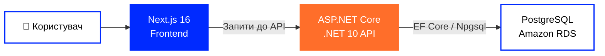
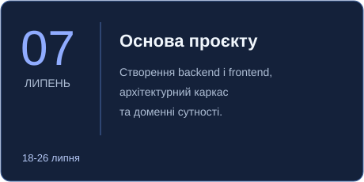
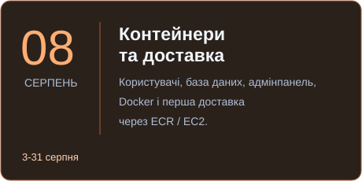
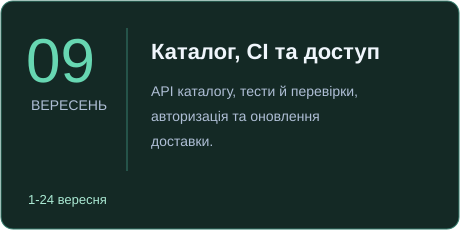
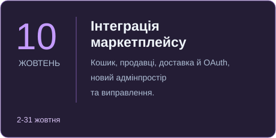
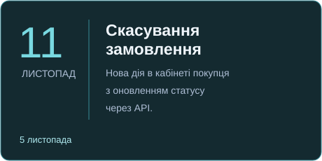

[🇬🇧 English](README.en.md) · **🇺🇦 Українська**

 

# 🛒 Treba Marketplace

### Маркетплейс · Хмарна інфраструктура · DevOps

Командний маркетплейс із каталогом, кошиком, кабінетами покупця та продавця. 
Frontend, backend API і доставку змін команда розвивала окремо.

 

 

---

<strong>🗺️ Навігація</strong>

<table width="100%">
<tr>
<td width="300" valign="top">

**Проєкт**

- [Про TREBA](#treba-about)
- [Можливості TREBA](#treba-features)
- [Основні технології](#treba-tech)
- [Рівень даних](#treba-data)
- [Репозиторії](#treba-repositories)

</td>
<td width="300" valign="top">

**Розробка**

- [AWS та DevOps](#treba-devops)
- [Архітектура системи](#treba-architecture)
- [CI/CD](#treba-cicd)
- [Історія розвитку](#treba-roadmap)
- [Помилки та виправлення](#treba-incidents)
- [Команда](#treba-team)

</td>
</tr>
</table>

---

## Дослідіть проєкт

<table width="100%">
<tr>
<td width="50%" valign="top">

### 🕓 Історія

Від першого завдання 18 липня до розвитку маркетплейсу. Етапи, дати й головні зміни.

[Відкрити історію →](docs/history/project-history.md) · [Журнал за днями →](docs/history/daily-log.md)

</td>
<td width="50%" valign="top">

### 👥 Команда

Хто працював над TREBA, за які частини відповідав і які зміни залишив у проєкті.

[Переглянути команду →](docs/team/README.md)

</td>
</tr>
<tr>
<td width="50%" valign="top">

### 🛠️ Помилки та виправлення

Історії про збої CI, розгортання та роботу застосунку: що сталося і як це виправили.

[Читати розбори →](docs/incidents/README.md)

</td>
<td width="50%" valign="top">

### 🏗️ Архітектура

Як пов'язані frontend, backend API, база даних і доставка змін.

[Переглянути архітектуру →](docs/architecture.md)

</td>
</tr>
</table>

---

## 👋 Про Treba

**Treba**: командний маркетплейс із каталогом товарів, кошиком, замовленнями та просторами для покупця, продавця й адміністратора. Покупець бачить товари у вебінтерфейсі, а дані й основні операції надходять із backend API.

Frontend побудований на Next.js і React. Backend на ASP.NET Core працює з користувачами, каталогом, покупками та PostgreSQL. Для збірки й доставки команда використовує Docker, GitHub Actions та сервіси AWS.

---

## 🛍️ Що вже є в TREBA

Нижче зібрано основні функції TREBA. Посилання на PR показують, як вони з'являлися у проєкті.

| Напрям | Що є в проєкті |
|---|---|
| Каталог | Категорії, бренди, атрибути, варіанти та фото товарів у [backend PR #23-30](https://github.com/tr3ba/treba-backend/pull/23); API шар і сторінки товарів у [frontend PR #15](https://github.com/tr3ba/treba-frontend/pull/15); моки прибрано у [#31](https://github.com/tr3ba/treba-frontend/pull/31). |
| Покупки | Кошик і замовлення через API: [frontend #32](https://github.com/tr3ba/treba-frontend/pull/32), [backend #38](https://github.com/tr3ba/treba-backend/pull/38) і [#55](https://github.com/tr3ba/treba-backend/pull/55). Скасування замовлення покупцем: [frontend #56](https://github.com/tr3ba/treba-frontend/pull/56); список бажань [backend #53](https://github.com/tr3ba/treba-backend/pull/53), [frontend #29](https://github.com/tr3ba/treba-frontend/pull/29). |
| Доставка | Відділення й поштомати Нової Пошти та кур'єр TREBA: [backend #86](https://github.com/tr3ba/treba-backend/pull/86), [frontend #42](https://github.com/tr3ba/treba-frontend/pull/42); пошук пунктів уточнено у [backend #88](https://github.com/tr3ba/treba-backend/pull/88), [frontend #43](https://github.com/tr3ba/treba-frontend/pull/43). |
| Обліковий запис | Реєстрація й відновлення пароля через email/SMS у [backend #94](https://github.com/tr3ba/treba-backend/pull/94), [frontend #49](https://github.com/tr3ba/treba-frontend/pull/49); Google/Facebook вхід у [backend #91](https://github.com/tr3ba/treba-backend/pull/91), [frontend #45](https://github.com/tr3ba/treba-frontend/pull/45). |
| Продавці | Заявки продавців і керування ними [backend #80](https://github.com/tr3ba/treba-backend/pull/80), [frontend #36](https://github.com/tr3ba/treba-frontend/pull/36); імпорт товарів і категоризація [backend #64](https://github.com/tr3ba/treba-backend/pull/64); публічна сторінка продавця [frontend #25](https://github.com/tr3ba/treba-frontend/pull/25). |
| Спілкування й відгуки | Приватні звернення до TREBA та питання про товар [backend #66](https://github.com/tr3ba/treba-backend/pull/66), [frontend #26](https://github.com/tr3ba/treba-frontend/pull/26); відгуки після отримання замовлення [backend #93](https://github.com/tr3ba/treba-backend/pull/93), [frontend #48](https://github.com/tr3ba/treba-frontend/pull/48). |
| Адміністрування | Адміністративний інтерфейс перенесено у Next.js `/admin` у [frontend #50](https://github.com/tr3ba/treba-frontend/pull/50); старий backend інтерфейс виведено у [backend #96](https://github.com/tr3ba/treba-backend/pull/96). |
| Доставка змін | Build, Docker/ECR і EC2 workflows у [backend](https://github.com/tr3ba/treba-backend/tree/main/.github/workflows) та [frontend](https://github.com/tr3ba/treba-frontend/tree/main/.github/workflows); експерименти з Kubernetes у [backend #52](https://github.com/tr3ba/treba-backend/pull/52) і [#56](https://github.com/tr3ba/treba-backend/pull/56). |

Як ці можливості з’являлися, показано в [історії проєкту](docs/history/project-history.md) та [журналі розробки](docs/history/daily-log.md).

---

## 🧩 Основні технології

<table width="100%">
<tr><th width="50%">🎨 Frontend</th><th width="50%">⚙️ Backend</th></tr>
<tr>
<td width="50%" align="center" valign="top">
 

 
<strong>Next.js</strong> <code>16.2.12</code>

Сторінки магазину, маршрути й серверні можливості.

</td>
<td width="50%" align="center" valign="top">
 

 
<strong>ASP.NET Core</strong> <code>.NET 10</code>

HTTP API для каталогу, користувачів і замовлень.

</td>
</tr>
<tr>
<td width="50%" align="center" valign="top">
 

 
<strong>React</strong> <code>19.2.4</code>

Компоненти інтерфейсу та взаємодія з користувачем.

</td>
<td width="50%" align="center" valign="top">
 

 
<strong>Entity Framework Core</strong> <code>10</code>

Моделі даних, запити до бази й міграції.

</td>
</tr>
<tr>
<td width="50%" align="center" valign="top">
 

 
<strong>TypeScript</strong> <code>5.x</code>

Типи для компонентів і запитів до API.

</td>
<td width="50%" align="center" valign="top">
 

 
<strong>Npgsql</strong> <code>10.0.3</code>

Підключення Entity Framework Core до PostgreSQL.

</td>
</tr>
</table>

---

## 🗄️ Рівень даних

<table width="100%">
<tr>
<td width="50%" align="center" valign="top">
 

 
<strong>PostgreSQL</strong>

Основна база даних маркетплейсу. Backend працює з нею через Entity Framework Core та Npgsql.

</td>
<td width="50%" align="center" valign="top">
 

 
<strong>Amazon RDS</strong>

Кероване PostgreSQL-середовище в архітектурі AWS.

</td>
</tr>
</table>

---

## ☁️ AWS & DevOps

<table width="100%">
<tr>
<th width="50%">🚀 Доставка та Runtime</th>
<th width="50%">🛡️ Операції та інфраструктура</th>
</tr>
<tr>
<td width="50%" align="center" valign="top">
 

 
<strong>Docker</strong>

Контейнеризація backend і frontend сервісів.

</td>
<td width="50%" align="center" valign="top">
 

 
<strong>AWS Systems Manager</strong>

Віддалене розгортання та виконання команд.

</td>
</tr>
<tr>
<td width="50%" align="center" valign="top">
 

 
<strong>GitHub Actions</strong>

Автоматизація збірки, тестів і доставки.

</td>
<td width="50%" align="center" valign="top">
 

 
<strong>Amazon CloudWatch</strong>

Моніторинг інфраструктури та сповіщення.

</td>
</tr>
<tr>
<td width="50%" align="center" valign="top">
 

 
<strong>Amazon ECR</strong>

Реєстр Docker-образів застосунку.

</td>
<td width="50%" align="center" valign="top">
 

 
<strong>AWS IAM</strong>

Керування доступом до інфраструктури.

</td>
</tr>
<tr>
<td width="50%" align="center" valign="top">
 

 
<strong>Amazon EC2</strong>

Сервер для розгорнутих контейнерів застосунку.

</td>
<td width="50%" align="center" valign="top">
 

 
<strong>AWS Secrets Manager</strong>

Доступ до секретів runtime-сервісів.

</td>
</tr>
</table>

---

## 🏗️ Архітектура системи

Treba складається з окремих рівнів **frontend**, **backend API** та **бази даних**.

Backend API та PostgreSQL-рівень реалізовані окремо від frontend.

Каталог підключено до API у [frontend PR #15](https://github.com/tr3ba/treba-frontend/pull/15); моки товарів, продавців і відгуків прибрано у [PR #31](https://github.com/tr3ba/treba-frontend/pull/31). Кошик авторизованого користувача й оформлення замовлення працюють через backend у [PR #32](https://github.com/tr3ba/treba-frontend/pull/32). Для гостя стан кошика зберігається в браузері до входу.

---

## 🚀 CI/CD Pipeline

```mermaid
flowchart LR

    DEV["Розробник"]
    GH["GitHub"]
    ACTIONS["GitHub<br/>Actions"]
    TEST["Build<br/>& Tests"]
    DOCKER["Docker<br/>Image"]
    ECR["Amazon<br/>ECR"]
    SSM["AWS Systems<br/>Manager"]
    EC2["Amazon<br/>EC2"]

    DEV --> GH
    GH --> ACTIONS
    ACTIONS --> TEST
    TEST --> DOCKER
    DOCKER --> ECR
    ECR --> SSM
    SSM --> EC2

    style DEV fill:#ffffff,color:#000000,stroke:#002AFF,stroke-width:2px
    style GH fill:#ffffff,color:#000000,stroke:#002AFF,stroke-width:2px
    style ACTIONS fill:#002AFF,color:#ffffff,stroke:#002AFF,stroke-width:2px
    style TEST fill:#002AFF,color:#ffffff,stroke:#002AFF,stroke-width:2px
    style DOCKER fill:#002AFF,color:#ffffff,stroke:#002AFF,stroke-width:2px
    style ECR fill:#FF6E2A,color:#ffffff,stroke:#FF6E2A,stroke-width:2px
    style SSM fill:#FF6E2A,color:#ffffff,stroke:#FF6E2A,stroke-width:2px
    style EC2 fill:#FF6E2A,color:#ffffff,stroke:#FF6E2A,stroke-width:2px
```

**GitHub → GitHub Actions → Build & Test → Docker → ECR → SSM → EC2**

У репозиторіях налаштовані CI/CD workflows для збірки, тестування,
створення Docker-образів, публікації в Amazon ECR та розгортання через AWS Systems Manager.

<strong>⚙️ Деталі CI/CD: Backend та Frontend</strong>

<table width="100%">
<tr>
<td width="460" valign="top">

### ⚙️ Backend

- restore та build
- автоматизовані тести
- Docker image build
- `/ping` smoke check контейнера
- публікація образів у ECR
- SSM-based deployment на EC2
- versioned `v*` release workflow

</td>
<td width="460" valign="top">

### 🎨 Frontend

- TypeScript check та Next.js build у Frontend Checks
- Node.js тести та Python unittest у Frontend Checks
- Docker image build
- публікація в ECR
- SSM-based deployment на EC2

</td>
</tr>
</table>

Приклади запусків доставки: [backend 30.10.2026](https://github.com/tr3ba/treba-backend/actions/runs/41083558386) і [frontend 31.10.2026](https://github.com/tr3ba/treba-frontend/actions/runs/41191308177). Скрипти використовують SHA-тег образу та зберігають попередній контейнер.

---

## 🕓 Історія розвитку

Від липневого каркаса до каталогу, покупок і кабінетів восени: тут зібрано головні етапи TREBA. Більше подій є в [історії проєкту](docs/history/project-history.md) та [журналі розробки](docs/history/daily-log.md).

Розгорніть потрібний місяць, щоб побачити події за днями. Дати наведено в UTC; відкриття PR і злиття позначені окремо.

<table width="100%">
<tr>
<td width="460" valign="top" align="left">

<strong>📅 Події за днями</strong>

<ul>
<li><strong>18.07</strong>: студентів поділили на команди, дали завдання зробити клон інтернет-магазину Rozetka та надали дизайн сайту.</li>
<li><strong>20.07</strong>: створено <a href="https://github.com/tr3ba/treba-backend/commit/a44ad6dca4be32cb07806f94cc4e55807950c459">backend</a> і <a href="https://github.com/tr3ba/treba-frontend/commit/e75d570a8240d7a05ed8c0f7b1523e530ca3a035">frontend</a>.</li>
<li><strong>25.07</strong>: <a href="https://github.com/tr3ba/treba-backend/pull/1">Відкрито PR архітектурної основи backend</a>.</li>
<li><strong>26.07</strong>: <a href="https://github.com/tr3ba/treba-backend/pull/1">Злито Clean Architecture і доменні сутності</a>.</li>
</ul>

</td>
<td width="460" valign="top" align="left">

<strong>📅 Події за днями</strong>

<ul>
<li><strong>03.08</strong>: <a href="https://github.com/tr3ba/treba-backend/pull/2">Відкрито PR адміністративної панелі</a>.</li>
<li><strong>08.08</strong>: <a href="https://github.com/tr3ba/treba-backend/pull/3">Відкрито Dockerfile PR backend і frontend</a>.</li>
<li><strong>13.08</strong>: <a href="https://github.com/tr3ba/treba-backend/commit/03f27a2e8331f0adbbc08bc81b79fff7b0199dc1">Виправлено тег .NET Docker-образу</a>.</li>
<li><strong>15.08</strong>: <a href="https://github.com/tr3ba/treba-backend/commit/47fd81cecaba9af965f21ef22cb9e91a6ba8a8cb">Додано backend README</a>.</li>
<li><strong>17.08</strong>: <a href="https://github.com/tr3ba/treba-backend/commit/1394fb622db21bb6b6a84c9429692852292325e3">Додано workflow збірки backend</a>.</li>
<li><strong>19.08</strong>: <a href="https://github.com/tr3ba/treba-backend/pull/3">Злито Docker-конфігурацію backend</a>.</li>
<li><strong>22.08</strong>: <a href="https://github.com/tr3ba/treba-backend/pull/5">Додано користувачів і підключення БД</a>.</li>
<li><strong>24.08</strong>: <a href="https://github.com/tr3ba/treba-backend/pull/2">Злито адміністративну панель</a>.</li>
<li><strong>30.08</strong>: <a href="https://github.com/tr3ba/treba-backend/pull/8">Додано ECR/EC2-доставку backend і SSM-виправлення</a>.</li>
<li><strong>31.08</strong>: <a href="https://github.com/tr3ba/treba-frontend/pull/5">Додано frontend-файли, Docker/ECR/EC2 і backend Compose</a>.</li>
</ul>

</td>
</tr>
<tr>
<td width="460" valign="top" align="left">

<strong>📅 Події за днями</strong>

<ul>
<li><strong>01.09</strong>: <a href="https://github.com/tr3ba/treba-backend/pull/10">Перенесено доставку на новий AWS account</a>.</li>
<li><strong>10.09</strong>: <a href="https://github.com/tr3ba/treba-backend/pull/11">Прибрано відстежувані build/IDE-артефакти</a>.</li>
<li><strong>13.09</strong>: <a href="https://github.com/tr3ba/treba-backend/pull/12">Додано API каталогу, smoke test, NuGet scan і тести</a>.</li>
<li><strong>14.09</strong>: <a href="https://github.com/tr3ba/treba-backend/pull/16">Злито workflow релізного образу</a>.</li>
<li><strong>16.09</strong>: <a href="https://github.com/tr3ba/treba-backend/pull/18">Додано DevOps-документацію й демонстрацію CI failure/fix</a>.</li>
<li><strong>17.09</strong>: <a href="https://github.com/tr3ba/treba-backend/pull/20">Прибрано dev-credentials БД; розширено керування користувачами</a>.</li>
<li><strong>18.09</strong>: <a href="https://github.com/tr3ba/treba-backend/pull/29">Розширено API каталогу, додано DB health і release tags</a>.</li>
<li><strong>19.09</strong>: <a href="https://github.com/tr3ba/treba-backend/pull/31">Злито авторизацію та виправлення доставки</a>.</li>
<li><strong>24.09</strong>: <a href="https://github.com/tr3ba/treba-frontend/pull/1">Закрито ранній frontend Docker PR без злиття</a>.</li>
</ul>

</td>
<td width="460" valign="top" align="left">

<strong>📅 Події за днями</strong>

<ul>
<li><strong>02.10</strong>: <a href="https://github.com/tr3ba/treba-backend/pull/38">Додано продавців, магазини й backend-кошик</a>.</li>
<li><strong>03.10</strong>: <a href="https://github.com/tr3ba/treba-frontend/pull/11">Додано inventory та frontend-сторінку кошика</a>.</li>
<li><strong>05.10</strong>: <a href="https://github.com/tr3ba/treba-frontend/commit/db0f09a7c808f493f4ab0ea627becf8194a09632">Додано коміти API-клієнта та завантаження каталогу</a>.</li>
<li><strong>06.10</strong>: <a href="https://github.com/tr3ba/.github/commit/115f8be5aab8e56f5ab2871d68b100542040f86d">Створено профіль .github; оновлено документацію й доставку</a>.</li>
<li><strong>07.10</strong>: <a href="https://github.com/tr3ba/treba-frontend/pull/18">Оновлено frontend Dockerfile та workflows</a>.</li>
<li><strong>08.10</strong>: <a href="https://github.com/tr3ba/treba-frontend/pull/15">Злито API-шар та адаптивний інтерфейс</a>.</li>
<li><strong>09.10</strong>: <a href="https://github.com/tr3ba/treba-backend/pull/51">Виправлено інтеграцію; прибрано dev-секрети</a>.</li>
<li><strong>10.10</strong>: <a href="https://github.com/tr3ba/treba-backend/pull/52">Додано Stage 5 Kubernetes-матеріали</a>.</li>
<li><strong>12.10</strong>: <a href="https://github.com/tr3ba/treba-frontend/pull/22">Відкрито PR Stage 5 frontend ECR-збірки</a>.</li>
<li><strong>13.10</strong>: <a href="https://github.com/tr3ba/treba-backend/pull/54">Додано wishlist та reviews</a>.</li>
<li><strong>14.10</strong>: <a href="https://github.com/tr3ba/treba-backend/pull/56">Додано orders і локальний Kubernetes CD</a>.</li>
<li><strong>15.10</strong>: <a href="https://github.com/tr3ba/treba-frontend/pull/23">Злито Stage 5 frontend ECR та початковий кабінет продавця</a>.</li>
<li><strong>17.10</strong>: <a href="https://github.com/tr3ba/treba-backend/pull/57">Відкрито PR платежів</a>.</li>
<li><strong>19.10</strong>: <a href="https://github.com/tr3ba/treba-backend/pull/58">Додано admin/Mini App, імпорт, promotions і seller landing</a>.</li>
<li><strong>20.10</strong>: <a href="https://github.com/tr3ba/treba-frontend/pull/26">Додано підтримку, сторінку продавця, галерею та wishlist</a>.</li>
<li><strong>21.10</strong>: <a href="https://github.com/tr3ba/treba-frontend/pull/32">Підключено checkout до API</a>; <a href="https://github.com/tr3ba/treba-backend/pull/57">злито платіжний модуль backend</a>.</li>
<li><strong>22.10</strong>: <a href="https://github.com/tr3ba/treba-frontend/pull/37">Додано заявки, фільтри й сповіщення; виправлено EC2 disk issue</a>.</li>
<li><strong>23.10</strong>: <a href="https://github.com/tr3ba/treba-backend/pull/83">Виправлено імпорт і локалізацію</a>.</li>
<li><strong>24.10</strong>: <a href="https://github.com/tr3ba/treba-backend/pull/84">Виправлено перевірку міграцій під час розгортання</a>; <a href="https://github.com/tr3ba/treba-backend/pull/78">злито зміни доставки</a>.</li>
<li><strong>25.10</strong>: <a href="https://github.com/tr3ba/treba-frontend/pull/40">Злито порівняння товарів і зміни шапки</a>.</li>
<li><strong>26.10</strong>: <a href="https://github.com/tr3ba/treba-backend/pull/86">Додано Нову Пошту, кур'єрську доставку й пошук пунктів</a>.</li>
<li><strong>27.10</strong>: <a href="https://github.com/tr3ba/treba-frontend/pull/44">Оновлено мобільний інтерфейс</a>; <a href="https://github.com/tr3ba/treba-backend/pull/89">продовжено роботу над OAuth</a>.</li>
<li><strong>28.10</strong>: <a href="https://github.com/tr3ba/treba-backend/pull/91">Виправлено OAuth і розгортання</a>, <a href="https://github.com/tr3ba/treba-backend/pull/92">розділено сесії</a> та <a href="https://github.com/tr3ba/treba-backend/pull/93">уточнено відгуки після доставки</a>.</li>
<li><strong>29.10</strong>: <a href="https://github.com/tr3ba/treba-frontend/pull/49">Додано верифікацію</a>, <a href="https://github.com/tr3ba/treba-frontend/pull/50">перенесено адмінпростір у frontend</a> та <a href="https://github.com/tr3ba/treba-frontend/pull/52">оновлено його дизайн</a>.</li>
<li><strong>30.10</strong>: <a href="https://github.com/tr3ba/treba-backend/pull/98">Додано відповіді на відгуки й допрацювання адмінпростору</a>.</li>
<li><strong>31.10</strong>: <a href="https://github.com/tr3ba/treba-frontend/pull/54">Злито frontend #54: фільтри та деталі користувача</a>.</li>
</ul>

</td>
</tr>
<tr>
<td colspan="2" valign="top" align="center">

<strong>📅 Події за днями</strong>

<ul>
<li><strong>05.11</strong>: <a href="https://github.com/tr3ba/treba-frontend/pull/56">Додано скасування замовлення покупцем</a> у вебінтерфейсі.</li>
</ul>

</td>
</tr>
</table>

[📖 Детальна історія](docs/history/project-history.md) · [📅 Журнал за днями](docs/history/daily-log.md) · [👥 Команда](docs/team/README.md)

---

## 🛠️ Помилки та виправлення

Три випадки з розробки: проблеми з місцем на сервері та міграціями бази даних. Повні розбори з посиланнями на зміни зібрано на окремій сторінці.

| Проблема | Що змінили | PR |
|---|---|---|
| **22.10 · Місце на EC2**: rollback-контейнери утримували старі образи. | Звільнення місця для доставки frontend. | [FE #37](https://github.com/tr3ba/treba-frontend/pull/37) |
| **23-24.10 · Міграція мов профілю**: deployment зупиняла відсутність міграції в allowlist. | Узгодження дозволеного переліку й тести міграцій. | [BE #84](https://github.com/tr3ba/treba-backend/pull/84) |
| **27-28.10 · UserExternalLogins**: перевірка використовувала іншу назву таблиці. | Визначення й quoting імені з EF metadata. | [BE #91](https://github.com/tr3ba/treba-backend/pull/91) |

[Повні розбори проблем і виправлень →](docs/incidents/README.md)

---

## 👥 Люди в історії проєкту

TREBA розвивала команда з різними напрямами роботи: від інтерфейсу магазину й API до доставки в AWS. Коротко про учасників нижче; більше про їхній внесок є на [сторінці команди](docs/team/README.md).

<table width="100%">
<tr>
<td width="50%" valign="top">

### [amonezeer](docs/team/README.md#author-amonezeer)

API · адмінпростір · інтеграція 
Приклад роботи: [перенесення адмінпростору](https://github.com/tr3ba/treba-backend/pull/96)

</td>
<td width="50%" valign="top">

### [F1eshka](docs/team/README.md#author-f1eshka)

Інтерфейс магазину · UX 
Приклад роботи: [сторінки каталогу](https://github.com/tr3ba/treba-frontend/pull/15)

</td>
</tr>
<tr>
<td width="50%" valign="top">

### [thewhitemage13](docs/team/README.md#author-thewhitemage13)

Каталог · кошик · відгуки 
Приклад роботи: [API каталогу](https://github.com/tr3ba/treba-backend/pull/12)

</td>
<td width="50%" valign="top">

### [Quixar](docs/team/README.md#author-quixar)

Авторизація · замовлення · оплата 
Приклад роботи: [авторизація](https://github.com/tr3ba/treba-backend/pull/31)

</td>
</tr>
<tr>
<td width="50%" valign="top">

### [Broadcast1Storm](docs/team/README.md#author-broadcast1storm)

Контейнери · CI/CD · AWS 
Приклад роботи: [доставка через ECR](https://github.com/tr3ba/treba-backend/pull/6)

</td>
<td width="50%" valign="top">

### 📖 Усі автори змін

[Переглянути внесок команди →](docs/team/README.md)

</td>
</tr>
</table>
---

## 📦 Репозиторії Treba

<table width="100%">
<tr>
<td width="460" valign="top">

### Backend

ASP.NET Core · .NET 10

Структуроване backend-рішення:

`Application` · `Contracts` · `Domain` · `Infrastructure` · `WebApi`

Містить API для каталогу, товарів, категорій, брендів, варіантів,
кошика, продавців, магазинів, користувачів та адміністративних функцій.

Автентифікація включає реєстрацію, login,
refresh/logout та підтримку двофакторної автентифікації.

</td>
<td width="460" valign="top">

### Frontend

Next.js 16 · React 19

Сучасний інтерфейс маркетплейсу, написаний переважно на TypeScript.

Містить UI каталогу, навігацію, представлення товарів,
інтерфейс автентифікації та функціональність кошика.

Каталог, автентифікація та кошик авторизованого користувача підключені до backend API; кошик гостя зберігається в браузері до входу.

</td>
</tr>
<tr>
<td width="460" align="center">

</td>
<td width="460" align="center">

</td>
</tr>
</table>

---

