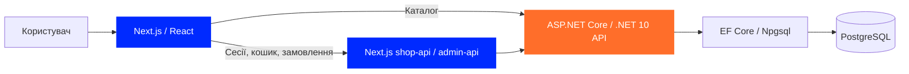
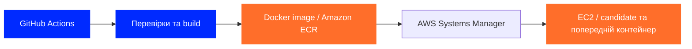

# Архітектура TREBA

### Від сторінки товару до замовлення та доставки змін

[English](architecture.en.md) · **Українська**

    

[Головна](../README.uk.md) · [Історія](history/project-history.md) · [Команда](team/README.md)

TREBA складається з вебінтерфейсу, окремого API та PostgreSQL. Frontend показує каталог, кошик, кабінети й адміністративні сторінки. Backend відповідає за бізнес-логіку, доступ і роботу з даними.

## Як проходить запит

| Частина | За що відповідає |
|---|---|
| **Frontend** | Next.js, React і TypeScript. Сторінки магазину, кабінет покупця, продавця та адміністративний простір. |
| **Backend API** | ASP.NET Core і .NET 10. Каталог, облікові записи, замовлення, продавці, відгуки та інтеграції. |
| **Дані** | Entity Framework Core і Npgsql працюють з PostgreSQL. |

### Основні сценарії

- **Каталог.** Сторінки товарів отримують дані через [API-шар frontend](https://github.com/tr3ba/treba-frontend/pull/15) та [API каталогу backend](https://github.com/tr3ba/treba-backend/pull/12).
- **Покупка.** Для авторизованого користувача [кошик і checkout](https://github.com/tr3ba/treba-frontend/pull/32) звертаються до backend. Гостьовий кошик зберігається у браузері до входу.
- **Доступ.** Маршрути shop-api й admin-api допомагають розділити клієнтські та staff-сесії. [Google/Facebook вхід](https://github.com/tr3ba/treba-backend/pull/91) додано окремо від звичайної реєстрації.
- **Адміністрування.** Інтерфейс працює у frontend /admin після [перенесення з backend](https://github.com/tr3ba/treba-frontend/pull/50). Backend надає необхідні API.

## Як доставляються зміни

Backend і frontend мають окремі GitHub Actions workflows. Після перевірок збираються Docker-образи, публікуються в ECR і розгортаються на EC2 через Systems Manager. Скрипти перевіряють новий контейнер і зберігають попередній для повернення застосунку.

[Backend workflow](https://github.com/tr3ba/treba-backend/blob/main/.github/workflows/deploy-backend.yml) · [Frontend workflow](https://github.com/tr3ba/treba-frontend/blob/main/.github/workflows/deploy-frontend.yml) · [Розбір проблем доставки](incidents/README.md)

## Середовища

| Середовище | Використання |
|---|---|
| **AWS / EC2** | Доставка Docker-образів через ECR і SSM, запуск backend та frontend. |
| **Docker Compose** | Локальний запуск застосунку й PostgreSQL для розробки. |
| **Kubernetes Stage 5** | Окрема локальна гілка експериментів із Deployment, probes, ingress і migration Job. |

[Backend README](https://github.com/tr3ba/treba-backend/blob/main/README.md) · [Frontend README](https://github.com/tr3ba/treba-frontend/blob/main/README.md) · [На головну](../README.uk.md)
